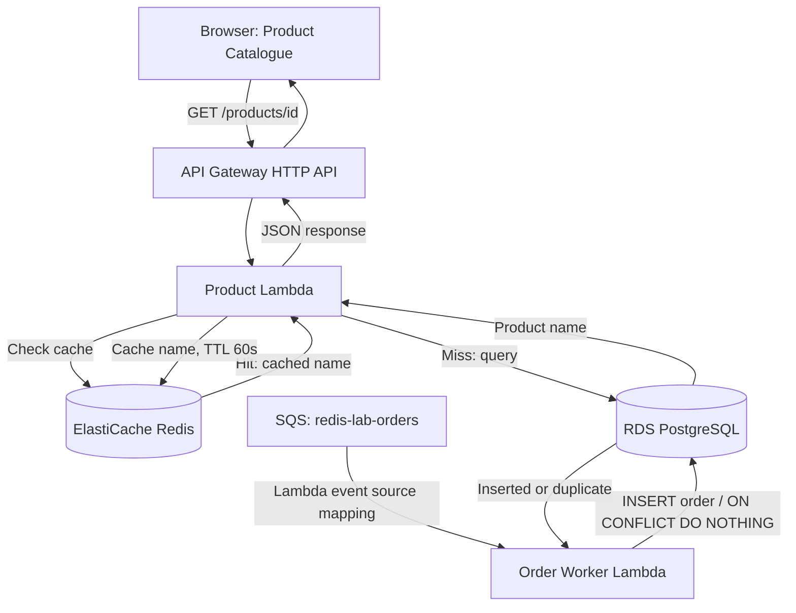

# AWS Redis Cache-Aside Lab

A hands-on AWS distributed systems lab demonstrating **Redis cache-aside** for product reads and **asynchronous, idempotent order insertion** using Amazon SQS, AWS Lambda, and PostgreSQL.

**What it demonstrates:** A product lookup first checks Redis. A cache hit returns immediately from Redis; a miss queries PostgreSQL, caches the product name for **60 seconds**, and returns the result. The API response reports which source served the request.

## Architecture



**Networking:** Both Lambda functions access PostgreSQL inside the AWS VPC; the product Lambda also accesses Redis. Redis and RDS are not publicly accessible. An EC2 instance was used for development and for serving the demo frontend through an SSH tunnel.

## Tech stack

| Layer | Technology |
| --- | --- |
| Frontend | HTML, CSS, vanilla JavaScript |
| API | Amazon API Gateway HTTP API |
| Compute | AWS Lambda (product API and order worker), Python |\n| Messaging | Amazon SQS Standard queue (at-least-once delivery) |
| Cache | Amazon ElastiCache for Redis OSS, TLS |
| Database | Amazon RDS for PostgreSQL, SSL |
| Development | Amazon EC2, SSH, AWS Systems Manager |
| Version control | Git and GitHub |

## How cache-aside works

1. The browser requests `GET /products/2`.
2. Lambda checks Redis for the key `product:2`.
3. **Hit:** Lambda returns the cached product with `"source": "redis"`.
4. **Miss:** Lambda queries PostgreSQL, writes the result to Redis with a **60-second TTL**, and returns `"source": "postgresql"`.
5. After the TTL expires, the next lookup repopulates the cache.

Example responses observed during testing:

```json
{"product": "Keyboard", "source": "postgresql"}
```

```json
{"product": "Keyboard", "source": "redis"}
```

These demonstrate correct cache behavior; **latency improvements have not yet been benchmarked**.

## Asynchronous order processing and idempotency

A separate SQS Standard queue (`redis-lab-orders`) triggers the `redis-lab-order-worker` Lambda. The worker parses each message and inserts an order into PostgreSQL.

Example SQS message:

```json
{"order_id": "order_789", "product_id": 3, "quantity": 2}
```

The `orders` table uses `order_id` as its **primary key**. The worker uses:

```sql
INSERT INTO orders (order_id, product_id, quantity)
VALUES (%s, %s, %s)
ON CONFLICT (order_id) DO NOTHING
RETURNING order_id;
```

A first insert returns the order ID; a repeated message causes no new row and is logged as `DUPLICATE SKIPPED`. This was verified using Lambda test events, and the SQS-to-Lambda-to-PostgreSQL flow was verified with a real queue message.

**Current limitation:** This makes **order insertion** idempotent, not the full order lifecycle. Orders remain `pending`; payment, inventory deduction, state transitions, crash recovery, and dead-letter queue handling are not implemented yet. The worker currently uses default batch failure behavior, so a failed batch can be retried, and the database uniqueness constraint protects against repeated inserts.

## Repository files

- `lambda_function.py` — API Gateway event handling, Redis lookup, PostgreSQL fallback, JSON responses, and 60-second cache TTL.
- `order_worker.py` — SQS-triggered Lambda with PostgreSQL inserts and duplicate detection.\n- `app.py` — standalone Python script for testing the cache-aside pattern directly from EC2.
- `frontend/index.html` — product selector and browser `fetch()` client.
- `.gitignore` — excludes local environments, deployment archives, and common secret files.

## Running the demo

This project requires your **own AWS resources**; cloning the repository does not provision the infrastructure.

1. Create a PostgreSQL database with a `products` table containing `id` and `name`, and a Redis instance accessible to Lambda.
2. Configure Lambda networking and environment variables: `REDIS_HOST`, `DB_HOST`, `DB_NAME`, `DB_USER`, `DB_PASSWORD`. Deploy `lambda_function.py` with the `redis` and `psycopg2` dependencies.
3. Create an API Gateway HTTP API route `GET /products/{product_id}` integrated with Lambda. Configure CORS for the frontend's origin.
4. Update the API URL in `frontend/index.html` to your own API Gateway endpoint.
5. Serve the frontend from a web server, for example:

   ```bash
   cd frontend
   python3 -m http.server 8000
   ```

6. Open `http://localhost:8000`, select a product, and click **Get Product** twice within 60 seconds to compare cache miss and cache hit.\n\nFor the **order worker**, create an SQS Standard queue and a second Lambda using `order_worker.py` with `psycopg2`. Configure its VPC access to RDS, database environment variables (`DB_HOST`, `DB_PORT`, `DB_NAME`, `DB_USER`, `DB_PASSWORD`), and an SQS event source mapping. Create an `orders` table with a primary-key `order_id`, a foreign key to `products(id)`, `quantity`, and `status` columns. Send a test order message to the queue and inspect CloudWatch logs.

## Security and operational notes

- Do not commit database passwords, AWS credentials, private keys, or deployment ZIP files.
- The Lambda example reads credentials from environment variables; **AWS Secrets Manager** is preferable for production.
- The demonstration API has no authentication or rate limiting configured. Add these before exposing a production service.
- A public API and managed AWS resources can incur charges. Disable or delete unused resources when finished.
- The frontend in this lab was accessed via an SSH tunnel; it is **not currently deployed as a public website**.

## Future improvements

Implement safe order state transitions and crash recovery, dead-letter queue and partial-batch failure handling, inventory concurrency control, automated infrastructure provisioning (Terraform), latency and hit-rate measurements, CI/CD, API authentication, and static frontend hosting with S3 and CloudFront.
