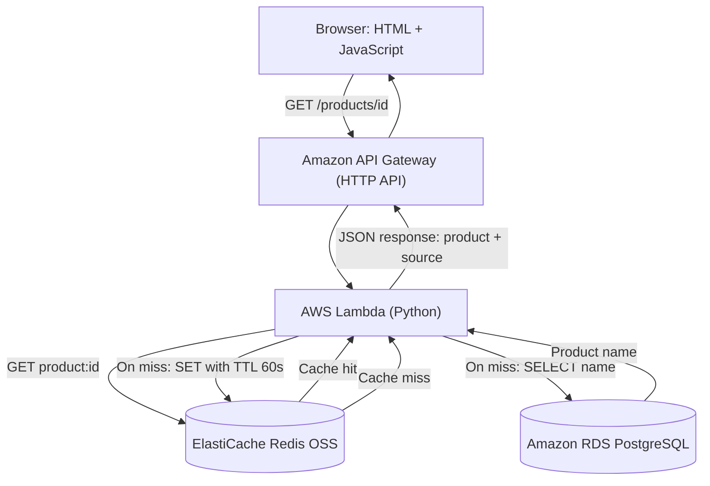

# AWS Redis Cache-Aside Lab

A hands-on AWS project demonstrating **cache-aside** with Amazon ElastiCache (Redis OSS), Amazon RDS for PostgreSQL, AWS Lambda, API Gateway, and a small JavaScript product catalogue.

**What it demonstrates:** A product lookup first checks Redis. A cache hit returns immediately from Redis; a miss queries PostgreSQL, caches the product name for **60 seconds**, and returns the result. The API response reports which source served the request.

## Architecture



**Networking:** Lambda, Redis, and RDS communicate inside an AWS VPC. Redis and RDS are not publicly accessible. An EC2 instance was used for development and for serving the demo frontend through an SSH tunnel.

## Tech stack

| Layer | Technology |
| --- | --- |
| Frontend | HTML, CSS, vanilla JavaScript |
| API | Amazon API Gateway HTTP API |
| Compute | AWS Lambda, Python |
| Cache | Amazon ElastiCache for Redis OSS, TLS |
| Database | Amazon RDS for PostgreSQL, SSL |
| Development | Amazon EC2, SSH, AWS Systems Manager |
| Version control | Git and GitHub |

## How cache-aside works

1. The browser requests `GET /products/2`.
2. Lambda checks Redis for the key `product:2`.
3. **Hit:** Lambda returns the cached product with `"source": "redis"`.
4. **Miss:** Lambda queries PostgreSQL, writes the result to Redis with a **60-second TTL**, and returns `"source": "postgresql"`.
5. After the TTL expires, the next lookup repopulates the cache.

Example responses observed during testing:

```json
{"product": "Keyboard", "source": "postgresql"}
```

```json
{"product": "Keyboard", "source": "redis"}
```

These demonstrate correct cache behavior; **latency improvements have not yet been benchmarked**.

## Repository files

- `lambda_function.py` — API Gateway event handling, Redis lookup, PostgreSQL fallback, JSON responses, and 60-second cache TTL.
- `app.py` — standalone Python script for testing the cache-aside pattern directly from EC2.
- `frontend/index.html` — product selector and browser `fetch()` client.
- `.gitignore` — excludes local environments, deployment archives, and common secret files.

## Running the demo

This project requires your **own AWS resources**; cloning the repository does not provision the infrastructure.

1. Create a PostgreSQL database with a `products` table containing `id` and `name`, and a Redis instance accessible to Lambda.
2. Configure Lambda networking and environment variables: `REDIS_HOST`, `DB_HOST`, `DB_NAME`, `DB_USER`, `DB_PASSWORD`. Deploy `lambda_function.py` with the `redis` and `psycopg2` dependencies.
3. Create an API Gateway HTTP API route `GET /products/{product_id}` integrated with Lambda. Configure CORS for the frontend's origin.
4. Update the API URL in `frontend/index.html` to your own API Gateway endpoint.
5. Serve the frontend from a web server, for example:

   ```bash
   cd frontend
   python3 -m http.server 8000
   ```

6. Open `http://localhost:8000`, select a product, and click **Get Product** twice within 60 seconds to compare cache miss and cache hit.

## Security and operational notes

- Do not commit database passwords, AWS credentials, private keys, or deployment ZIP files.
- The Lambda example reads credentials from environment variables; **AWS Secrets Manager** is preferable for production.
- The demonstration API has no authentication or rate limiting configured. Add these before exposing a production service.
- A public API and managed AWS resources can incur charges. Disable or delete unused resources when finished.
- The frontend in this lab was accessed via an SSH tunnel; it is **not currently deployed as a public website**.

## Future improvements

Add automated infrastructure provisioning (Terraform), latency and hit-rate measurements, CI/CD, API authentication, and static frontend hosting with S3 and CloudFront.
